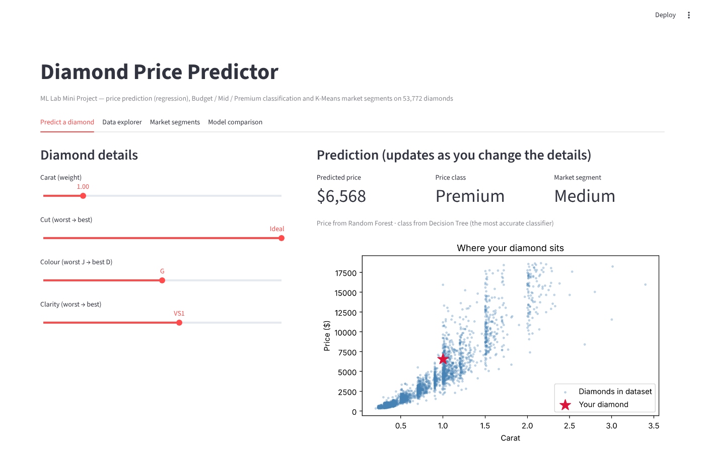
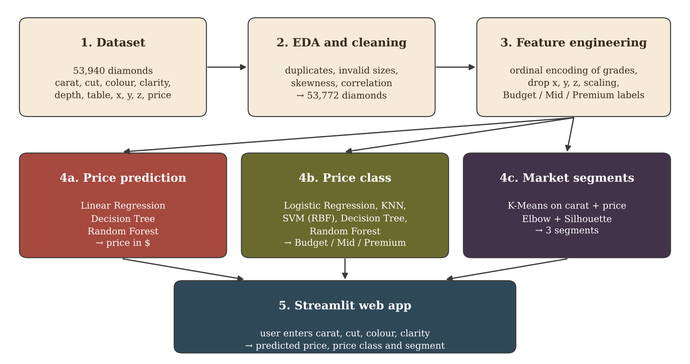
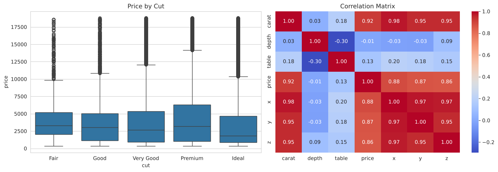
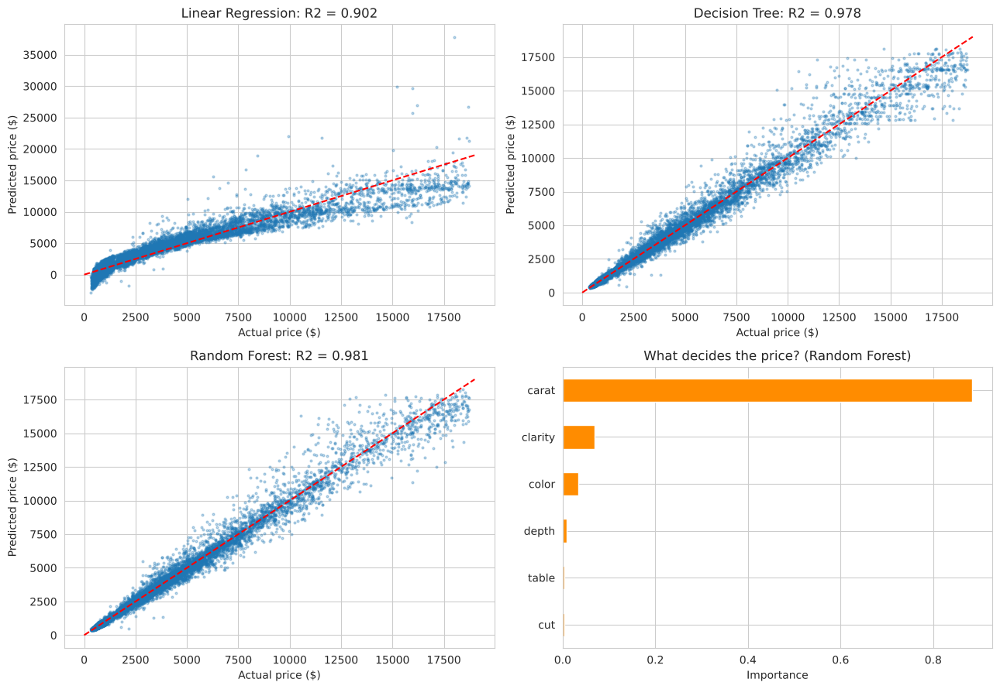
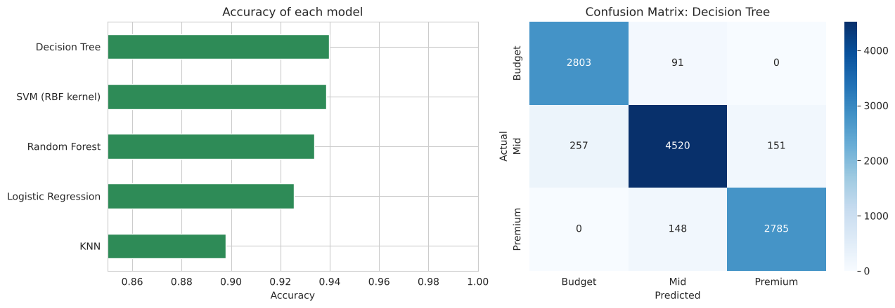
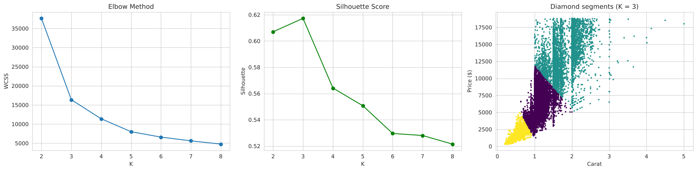

# Diamond Price Prediction and Classification

A machine learning project that predicts the **price** of a diamond, classifies it as **Budget, Mid or Premium**, and groups diamonds into **market segments**, using its carat, cut, colour, clarity, depth and table.

Made as the mini project for **Machine Learning Lab (AIM 3130)** at Manipal University Jaipur.



## What the project does

| Task | Type | Models |
|---|---|---|
| Predict the price in US dollars | Regression | Linear Regression, Decision Tree, Random Forest |
| Classify as Budget (< $1,000), Mid or Premium (> $5,000) | Classification | Logistic Regression, KNN, SVM (RBF), Decision Tree, Random Forest |
| Find market segments | Clustering | K-Means (K chosen by Elbow Method and Silhouette Score) |



## Dataset

The **Diamonds** dataset from the ggplot2 package (also in seaborn and on [Kaggle](https://www.kaggle.com/datasets/shivam2503/diamonds)): 53,940 round-cut diamonds with 10 columns, with prices in US dollars from around 2008.

**Cleaning:** 146 duplicate rows and 22 rows with zero or impossible sizes were removed, leaving **53,772 diamonds**. Cut, colour and clarity were ordinally encoded (they are ordered grades), and x, y, z were dropped because they are about 0.98 correlated with carat. All models use an 80:20 train–test split (`random_state = 42`); StandardScaler is fitted on the training data only.



## Results (on the test set)

**Price prediction**

| Model | MAE ($) | RMSE ($) | R² |
|---|---|---|---|
| Linear Regression | 855 | 1,233 | 0.9021 |
| Decision Tree | 308 | 585 | 0.9780 |
| **Random Forest** | **280** | **536** | **0.9815** |

Carat is by far the most important feature (importance 0.883), followed by clarity (0.068) and colour (0.034).



**Price-class classification**

| Model | Accuracy | Macro F1 |
|---|---|---|
| **Decision Tree** (max_depth 10) | **93.98%** | **0.9413** |
| SVM (RBF kernel) | 93.84% | 0.9398 |
| Random Forest | 93.36% | 0.9350 |
| Logistic Regression | 92.54% | 0.9270 |
| KNN (K = 21) | 89.77% | 0.9001 |

- **Scaling matters for KNN:** without feature scaling, accuracy falls to 77.15%.
- **Overfitting:** a Decision Tree with no depth limit scores 98.82% on training data but only 92.52% on test data.



**Market segments (K-Means, K = 3, Silhouette 0.6173)**

| Segment | Diamonds | Average carat | Average price |
|---|---|---|---|
| Small & affordable | 31,183 | 0.47 | $1,370 |
| Medium | 16,659 | 1.08 | $5,498 |
| Large & luxury | 5,930 | 1.75 | $12,995 |



## Files

| File | What it is |
|---|---|
| `diamond_price_prediction.ipynb` | Full analysis: EDA, cleaning, all models and results |
| `app.py` | Streamlit web app (Predict a diamond, Data explorer, Market segments, Model comparison) |
| `diamonds.csv` | Dataset |
| `Diamond_Price_Prediction_Report.pdf` | Project report |
| `requirements.txt` | Python libraries needed |

## How to run

```bash
pip install -r requirements.txt

# Web app (opens at http://localhost:8501; the first load trains the models, about 20 seconds)
streamlit run app.py
```

To run the analysis, open `diamond_price_prediction.ipynb` in Jupyter or VS Code (in the same folder as `diamonds.csv`) and click **Run All** (about a minute).

## Tech stack

Python, pandas, NumPy, scikit-learn, Matplotlib, seaborn, Streamlit

## Author

Lavanya Agnihotri, B.Tech CSE (AI & ML), Manipal University Jaipur
